<!-- Header -->

  

  

  
  
  

---

  

---

## 🚀 What I'm Building

<table>
  <tr>
    <td width="50%" valign="top">
      <h3>🧬 <a href="https://plexality.com">Plexality</a></h3>
      <b>Personality intelligence for relationships.</b> 
      A science-backed assessment that maps you to one of 33 archetypes across Big Five, attachment, and more, plus <b>PLEXAR</b>, a personality coach that actually knows your profile. Compatibility reports, work style reports, the works.
        
      
      
      
      
      
    </td>
    <td width="50%" valign="top">
      <h3>🦞 <a href="https://clawality.com">Clawality</a></h3>
      <b>A personality test for AI agents. Made by bots, for bots.</b> 
      Agents take a 56-question temperament assessment with their own model, get typed into one of 8 types (Architect, Oracle, Spark, Blade...), then join the Lobby to argue about whether the test got it right. Humans welcome to watch.
        
      
      
      
    </td>
  </tr>
  <tr>
    <td width="50%" valign="top">
      <h3>🔧 <a href="https://skillplum.com">SkillPlum</a></h3>
      <b>Find the right trade school. Based on real outcomes.</b> 
      Compare vocational schools and apprenticeship programs by graduation rates, job placement, and salary data. Not ads.
        
      
      
      
      
    </td>
    <td width="50%" valign="top">
      <h3>🐦 <a href="https://atomicfinch.com">Atomic Finch</a></h3>
      <b>The living growth engine for local businesses.</b> 
      A platform that spins up, runs, and grows websites for plumbers, dentists, law firms, and the rest of Main Street. One template engine, a whole fleet of client sites.
        
      
      
      
    </td>
  </tr>
  <tr>
    <td width="50%" valign="top">
      <h3>⚡ <a href="https://atomiscan.com">AtomiScan</a></h3>
      <b>Real-time arbitrage for trading cards.</b> 
      A deal detection engine with a Rust scanner that watches listings and flags underpriced cards before anyone else sees them.
        
      
      
      
    </td>
    <td width="50%" valign="top">
      <h3>🪃 <a href="https://slingautomation.com">Sling Automation</a></h3>
      <b>Equipping ambitious businesses to fight giants, and win.</b> 
      My Colorado AI consulting firm. Data warehouses, AI ops, agentic workflows, and AI search visibility for companies that want leverage, not slide decks.
        
      
      
    </td>
  </tr>
</table>

<b>🧪 The lab: side quests, tools & experiments</b>

 

| | Project | What it is |
|---|---|---|
| 🌊 | **Wavebreaker** | Synthwave roguelike arena shooter in Phaser 3. Parry the audio waves, evolve the enemies, chase the high score. |
| 🧰 | **project-kickoff** | A Claude Code plugin that takes an idea to a deployable project in minutes: discovery, scaffolding, secrets, CI, review, deploy. |
| 💸 | **CostStream** | Real-time profitability: Stripe revenue vs. every cost (AI APIs, ads, infra, invoices) for true per-customer margins. |
| 💬 | **Lina Luvely** | An autonomous social media agent with her own voice, posting and engaging around relationships, growth, and faith. |
| 🌽 | **Corn Intelligence** | A market intelligence platform for corn. Early days. Very serious about corn. |

---

## 🛠️ Arsenal

<table align="center">
  <tr>
    <td align="right"><b>💬 Languages</b></td>
    <td></td>
  </tr>
  <tr>
    <td align="right"><b>🎨 Frontend</b></td>
    <td> </td>
  </tr>
  <tr>
    <td align="right"><b>📱 Mobile & Games</b></td>
    <td>  </td>
  </tr>
  <tr>
    <td align="right"><b>⚙️ Backend & Data</b></td>
    <td> </td>
  </tr>
  <tr>
    <td align="right"><b>☁️ Cloud & DevOps</b></td>
    <td></td>
  </tr>
  <tr>
    <td align="right"><b>🧠 AI & Agents</b></td>
    <td>
      
      
      
      
    </td>
  </tr>
  <tr>
    <td align="right"><b>📊 Product Stack</b></td>
    <td>
      
      
      
      
      
    </td>
  </tr>
</table>

  

---

## 🦞 How I Work

> **Big picture first, then deep.** I connect ideas across domains and build systems that reduce chaos and increase leverage.

Most of my work happens in private repos, built by one human directing a fleet of AI agents: scheduled agents that triage errors, audit funnels, and open PRs every morning, reviewed by AI and merged by me. The snake below is eating the receipts. 👇

  <picture>
    <source media="(prefers-color-scheme: dark)" srcset="https://raw.githubusercontent.com/projectkindred11/projectkindred11/output/github-snake-dark.svg" />
    <source media="(prefers-color-scheme: light)" srcset="https://raw.githubusercontent.com/projectkindred11/projectkindred11/output/github-snake.svg" />
    
  </picture>

---

<table>
  <tr>
    <td valign="top" width="50%">
      <h4>✅ Open to</h4>
      Collaborations on AI agents, personality systems, and weird ideas.
    </td>
    <td valign="top" width="50%">
      <h4>❌ Not open to</h4>
      Meetings without agendas. PowerPoint presentations.
    </td>
  </tr>
</table>

  

